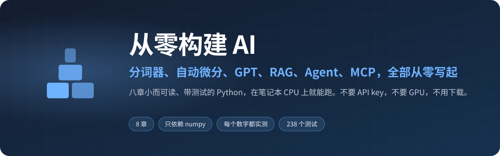

<div align="center">



<p>
<a href="https://github.com/zch6a/build-your-own-ai/actions/workflows/ci.yml"></a>


<a href="LICENSE"></a>
</p>

[English](README.md) · **简体中文**

小而可读、带测试的模块，在笔记本 CPU 上就能跑。不需要 API key，不需要 GPU，不需要下载模型。

</div>

---

大多数讲 LLM 系统原理的材料，要么停在一张示意图，要么第一步就是 `pip install` 要讲的那个东西。这里把每一块都写出来——几百行 Python，配上规定它必须做到什么的测试，和几秒钟就能跑完的演示——让你能读、能改、也能把它弄坏。

各章环环相扣：第 1 章的分词器喂给第 3 章的 GPT，GPT 用第 2 章的自动微分训练；第 4 章让它快速生成；第 5 章的索引支撑第 6 章的检索；第 7 章的 Agent 把检索当作工具调用；第 8 章再通过 Model Context Protocol 把这些工具提供给任何客户端——包括第 7 章的 Agent。

```text
                 corpus.py ── 生成的故事，以及虚构城镇的百科文章
                     │
   1 tokenizer.py ───┤  文本 ⇄ token id
   2 autograd.py  ───┤  梯度
   3 gpt.py, zoo.py ─┤  Transformer，训练一次后缓存
   4 generate.py  ───┘  快速生成（KV 缓存）、采样、嵌入
                            │
   5 vectordb.py  ──────────┤  精确搜索、HNSW
   6 rag.py, llm.py ────────┤  切块 → BM25 / LSA / 混合 → 带引用的回答；可选真实模型
   7 agent.py, planner.py ──┤  调用工具的循环；检索和计算作为工具
   8 mcp.py ────────────────┘  同样的工具，通过 stdio 提供给任何 MCP 客户端
```

> 各章的详细讲解目前是英文；下面每章附一段中文要点，数字都来自实际运行。

## 章节

| | 章节 | 你会写出 | 状态 |
|---|---|---|---|
| 1 | [分词器](chapters/01-tokenizer/README.md) | 字节级 BPE：训练、编码、特殊 token | ✅ |
| 2 | [自动微分](chapters/02-autograd/README.md) | 数组上的反向模式自动求导、Adam | ✅ |
| 3 | [GPT](chapters/03-gpt/README.md) | 一个在笔记本上两分钟训练完的 decoder-only Transformer | ✅ |
| 4 | [推理](chapters/04-inference/README.md) | KV 缓存（快 10 倍）、temperature、top-k / top-p、流式输出 | ✅ |
| 5 | [向量数据库](chapters/05-vectordb/README.md) | 先是精确搜索，再是 HNSW 索引，并测量召回率——以及向量里到底装了什么 | ✅ |
| 6 | [RAG](chapters/06-rag/README.md) | 切块、BM25、稠密（LSA）与混合检索、会引用出处或说“不知道”的回答——全部有测量 | ✅ |
| 7 | [Agent](chapters/07-agent/README.md) | 一个调用工具的循环：参数校验、错误回传、步数上限、沙箱工具；任何 OpenAI 兼容模型（包括 DeepSeek）都能直接接上 | ✅ |
| 8 | [MCP](chapters/08-mcp/README.md) | 一对基于 stdio 的 Model Context Protocol 服务端和客户端；Agent 的工具可以在 Claude Code 或任何 MCP 客户端里使用 | ✅ |

## 各章要点

1. **分词器。** 字节级 BPE：任何文本（任何文字、emoji、控制字符）都能无损往返。特殊 token 默认不可从文本中注入——文档里写着 `<|endoftext|>` 也不会变成真正的结束符。在本书的小语料上，训练 264 次合并后每个词都已是一个 token，于是自动停止：`vocab_size` 只是上限。
2. **自动微分。** 一个记录输入和反向函数的 `Tensor`，迭代式拓扑排序（5000 层的链也不会爆递归），广播的反向就是求和。每个算子都用有限差分校验过。一个真实的坑：float32 的梯度曾悄悄变成 float64。
3. **GPT。** GPT-2 的结构，39 万参数，CPU 上约 100 秒训练到验证 loss 0.62，写出基本合乎语法的故事（个别句子会坏掉，句子大多来自语法本身，整篇故事是新的组合）。训练更久时能看到一次**相变**：模型在平台期里“保持故事里同一个动物”的比例只比瞎猜（10%）略高，500 步之内突然学会复制（18% → 72% → 100%）——大模型里的 induction head 现象，在笔记本上复现。何时跳变取决于随机种子，跳变的突然性不变。还有两个反直觉的实测：去掉位置嵌入，loss 一点不变（因果遮罩本身就泄露了位置）；输出层不和嵌入表共享权重，loss 反而更低（0.52 对 0.62）。
4. **推理。** KV 缓存让生成快约 10 倍，且每一步的输出都与完整前向计算一致。temperature 0.5–1.0 流畅，1.5 开始崩，2.5 是胡话；top-k / top-p 能把 1.5 拉回来。
5. **向量数据库。** 从零实现 HNSW：8000 个向量只看 5% 就达到 recall@10 0.95，集合扩大 8 倍、工作量只多 1.4 倍；论文的邻居选择启发式比“保留最近的 M 个”高 21 个点召回。最有意思的发现：用 GPT 的隐藏状态做嵌入，搜到的是**句型**相同而不是**内容**相同的句子——只训练过预测下一个 token 的模型，最需要知道的是语法位置。
6. **RAG。** 60 篇虚构城镇的百科（任何模型都不可能背过）和 360 个问题。给每个块加上文档标题，小块的 hit@5 从 0.38 翻倍到 0.74；LSA 的 hit@5 更高，其实只是把整篇文章都捞了回来。替身读者遵守两条规则（必须引用**讲这个对象**的段落，否则说“不知道”）：69% 答对、31% 说不知道、**0% 答错**；69% 正好等于把正确文章直接交给它时的上限。
7. **Agent。** 模型从不执行任何东西，它只是“请求”调用工具，由程序决定。把错误回传给模型而不是直接停止：30% 的工具调用出错时，成功率 99% 对比 54%。当搜索结果里没有答案时换一种方式再搜，把成功率从 84% 提到 100%——这正是 Agent 胜过固定流程的地方。计算器从不 `eval()`，读文件工具有沙箱（连符号链接逃逸都测了）。
8. **MCP。** stdin/stdout 上的 JSON-RPC 2.0：握手与版本协商、`tools/list`、`tools/call`，协议错误与工具错误分开处理。第 7 章的 Agent 通过 MCP 跑 199 个任务，答案与进程内调用完全一致，每次调用只多 0.1 毫秒。

## 运行

```bash
git clone https://github.com/zch6a/build-your-own-ai.git && cd build-your-own-ai
uv sync                                        # Python 3.10+；唯一的依赖是 numpy
uv run pytest                                  # 所有章节的测试
uv run python chapters/01-tokenizer/run.py     # 某一章的演示
```

不用 uv：在虚拟环境里 `pip install -e . pytest`，然后 `python -m pytest`、`python chapters/01-tokenizer/run.py`。

演示都在几秒内跑完；只有从第 3 章起的第一个演示要先训练共享的故事模型——笔记本 CPU 上约两分钟，只训练一次，缓存在 `checkpoints/`（或 `$BYOAI_CHECKPOINTS`）。

**可选：接一个真实模型。** 第 6、7 章默认用离线替身运行。想用任何 OpenAI 兼容的接口（DeepSeek、OpenAI、本地服务）试一试，设置 `BYOAI_LLM_BASE_URL`、`BYOAI_LLM_MODEL`、`BYOAI_LLM_API_KEY` 即可，见 [`byoai/llm.py`](byoai/llm.py)。例如 DeepSeek：

```bash
export BYOAI_LLM_BASE_URL=https://api.deepseek.com BYOAI_LLM_MODEL=deepseek-flash BYOAI_LLM_API_KEY=...
uv run python chapters/07-agent/run.py
```

（服务商会更换模型名，以其官方文档为准。）不设置 `BYOAI_LLM_BASE_URL` 就不会向任何地方发送任何东西——环境里只有一个 API key 不会自动启用。

**把工具接进你自己的 Agent。** `uv run python -m byoai.mcp` 是一个可用的 MCP 服务端（stdio），提供第 7 章的工具。加到 Claude Code：
`claude mcp add towns -- uv run --directory /path/to/build-your-own-ai python -m byoai.mcp`。

## 开始之前

**需要：** Python，以及会用 numpy（理解数组形状和 `@`）。懂矩阵乘法和微积分里的链式法则会更轻松；logits、注意力、嵌入等概念都会在第一次出现时解释。

**阅读顺序：** 按 1 → 8 读，每章都用到前面的章节。每章大约一个晚上，做练习会更久。时间不够的话，把“一个预测下一个 token 的模型”当作已知，第 5–8 章（搜索、检索、Agent、MCP）可以单独读。

**耗时：** 从第 3 章起的第一个演示要先训练一次共享模型（约两分钟）。缓存按源代码区分，所以为了做练习改了 `gpt.py` 会重新训练——这是有意的。

## 常见问题

**为什么用 numpy 而不是 PyTorch？** 为了什么都不藏：第 2 章的每个梯度都是能读的代码，第 4 章的推理引擎展示了框架替你做了什么。思路可以一一对应过去。

**我的数字和文档里略有不同。** 耗时取决于机器；其余在给定种子和代码时都是确定的——同样的运行，loss 逐步相同。

**怎么从头再来？** 删掉 `checkpoints/`（或把 `BYOAI_CHECKPOINTS` 指向别处）。

**文档里其他数字从哪来？** 来自各章的演示（`run.py`）和旁边的实验脚本：`chapters/03-gpt/longer.py` 和 `ablations.py`、`chapters/05-vectordb/random_vs_clustered.py`、`chapters/06-rag/lsa_whole_article.py`，以及变异测试用的 `scripts/mutate.py`。其中跑得快的由 `tests/test_published_numbers.py` 固定住。

## 原则

- **从零开始，但不是玩具。** 每个模块都是在小规模上做真东西——像 GPT 分词器那样的字节级 BPE，而不是一张字符表——并说明生产系统在哪里不同。
- **哪里都能跑。** 唯一的依赖是 numpy。训练数据由 [`byoai/corpus.py`](byoai/corpus.py) 按种子生成，每台机器看到的文本都一样，不需要下载，也没有版权问题。
- **有测试。** 测试也是讲解的一部分：它们写明了每一块必须保证什么（无损往返、无法被注入的特殊 token、确定性的训练、沙箱逃不出去）。测试本身也被检验过：逐个故意植入 29 个 bug（去掉注意力缩放、丢掉因果遮罩、关掉沙箱检查……），每一个都会让某个测试失败。
- **先测量，再描述。** 讲解里的每个数字都是跑出来的；结果和预想不同时（相变出现的时机、LSA 的“高召回”），写的是实际结果和原因。

## 许可证

[MIT](LICENSE)
